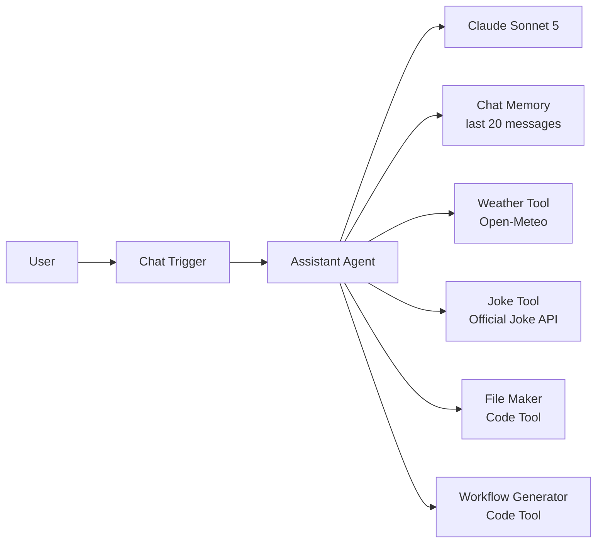

# NOVA — AI Weather, Joke, File & Workflow Maker

An n8n chat workflow that turns Claude into a friendly multi-tool assistant with four abilities: **live weather**, **random jokes**, **text-to-file packaging**, and **n8n workflow generation**.


---

## Overview

NOVA is a single n8n workflow built on the LangChain agent node. It connects Claude to four tools and exposes the result through n8n's built-in chat interface. Weather and joke data come from free, keyless public APIs; file and workflow generation run locally in Code Tool nodes.

- **No backend required** — runs entirely inside n8n
- **One credential** — Anthropic (or n8n Cloud gateway credits)
- **Import-ready** — a single JSON export
- **Chat-first** — streaming responses in n8n's chat panel

---

## Tools at a glance

| Tool | What it does | Input | External API | API key |
| --- | --- | --- | --- | --- |
| **Weather Tool** | Current conditions + 3-day forecast for any city | Latitude, longitude | [Open-Meteo](https://open-meteo.com/) | No |
| **Joke Tool** | Returns a random setup and punchline | None | [Official Joke API](https://github.com/15Dkatz/official_joke_api) | No |
| **File Maker** | Packages text into a named, sanitized file and shows its contents | `{"filename":"...","content":"..."}` | None | No |
| **Workflow Generator** | Builds importable n8n workflow JSON from a step list | `{"name":"...","steps":["..."]}` | None | No |

> The only credential is the Claude model. On n8n Cloud, built-in gateway credits can be used; on self-hosted n8n, add your own Anthropic API key.

---

## Architecture



**8 functional nodes + 1 sticky note** ("Read Me") on the canvas.

| Node | Type | Purpose |
| --- | --- | --- |
| Chat Trigger | `chatTrigger` | Opens the chat interface, streams replies |
| Assistant Agent | `agent` | Orchestrates Claude and decides which tool to call |
| Claude Model | `lmChatAnthropic` | Language model (`claude-sonnet-5`, temperature 0.7) |
| Chat Memory | `memoryBufferWindow` | Keeps the last 20 messages of context |
| Weather Tool | `httpRequestTool` | Calls Open-Meteo with AI-supplied coordinates |
| Joke Tool | `httpRequestTool` | Fetches a random joke |
| File Maker | `toolCode` | Validates and formats file content |
| Workflow Generator | `toolCode` | Produces n8n workflow JSON |
| Read Me | `stickyNote` | Setup notes on the canvas |

---

## Quick start

### Prerequisites

- An n8n instance ([Cloud](https://n8n.io/cloud/) or self-hosted)
- An Anthropic API key, or n8n Cloud credits

### 1. Get the workflow

```bash
git clone https://github.com/hamza9156/AI-Weather-Joke-File-and-Workflow-Maker.git
cd AI-Weather-Joke-File-and-Workflow-Maker
```

Or download `ai-weather-joke-file-workflow-maker.json` directly.

### 2. Import into n8n

1. Open n8n and create a new workflow.
2. Open the **⋯** menu (top right) and choose **Import from File**.
3. Select `ai-weather-joke-file-workflow-maker.json`.
4. Open the **Claude Model** node and select or create an **Anthropic** credential.
5. Save the workflow.

Self-hosted CLI alternative:

```bash
n8n import:workflow --input=ai-weather-joke-file-workflow-maker.json
```

### 3. Chat

Click **Chat** (or **Open chat**) in the workflow and try the prompts below.

---

## Example prompts

| Goal | Prompt |
| --- | --- |
| Weather | `What is the weather in Karachi?` |
| Forecast | `Will it rain in Lahore over the next three days?` |
| Joke | `Tell me a programming joke.` |
| File | `Save a shopping list with milk, eggs and bread as list.txt` |
| Workflow | `Make me an n8n workflow that fetches data, filters it and sends an email` |

---

## Tool reference

### Weather Tool

- **Endpoint:** `https://api.open-meteo.com/v1/forecast`
- **Parameters:** `latitude`, `longitude` (from the model via `$fromAI`), `current`, `daily`, `timezone=auto`, `forecast_days=3`
- **Current fields:** temperature, apparent temperature, relative humidity, precipitation, weather code, wind speed
- **Daily fields:** weather code, min/max temperature, max precipitation probability
- **Timeout:** 15 seconds

The agent resolves the city to decimal coordinates before calling the tool, then translates the WMO `weather_code` into plain language (clear, fog, drizzle, rain, snow, showers, thunderstorm).

### Joke Tool

- **Endpoint:** `https://official-joke-api.appspot.com/random_joke`
- **Input:** none
- **Timeout:** 10 seconds
- The agent may also tell its own joke if the API is unavailable.

### File Maker

Input (as a JSON string):

```json
{
  "filename": "reports/summer-sale.txt",
  "content": "Item 1\nItem 2"
}
```

Behaviour:

- Falls back to `output.txt` if no filename is supplied
- Strips path separators and unsafe characters (`\ / : * ? " < > |`)
- Collapses `..`, repeated dashes, and leading dots/dashes
- Adds `.txt` when no extension is present
- Reports filename, ISO timestamp, byte size, and the wrapped content

> **This does not write to disk.** It returns formatted text that the agent shows in a fenced code block, ready for the user to copy and save.

### Workflow Generator

Input (as a JSON string):

```json
{
  "name": "Lead intake",
  "steps": ["Receive form", "Validate email", "Add to CRM", "Send welcome email"]
}
```

Output: a complete, importable workflow object containing:

- A **Manual Trigger** node
- One **No Operation** placeholder per step, laid out left to right
- Correct `connections` between consecutive nodes
- Unique, deduplicated node names
- `active: false`, `settings.executionOrder: "v1"`, `pinData`, `meta`, and `tags`

> Placeholder nodes are intentional: generated workflows give you the skeleton, and you replace each NoOp node with the real integration (HTTP Request, Gmail, Slack, database, etc.).

---

## Customization

| Change | Where |
| --- | --- |
| Swap the model | **Claude Model** → model dropdown (e.g. another Claude model) |
| Adjust creativity | **Claude Model** → temperature (default `0.7`) |
| Longer memory | **Chat Memory** → `contextWindowLength` (default `20`) |
| Longer forecast | **Weather Tool** → `forecast_days` query parameter |
| Different joke source | **Joke Tool** → URL |
| Tool instructions | **Assistant Agent** → system message |
| Add a tool | Add an HTTP Request Tool or Code Tool node and connect it to the agent's `ai_tool` input |

The agent's system message defines NOVA's personality and routing rules. Edit it to change tone, add constraints, or document new tools.

---

## Troubleshooting

| Symptom | Likely cause | Fix |
| --- | --- | --- |
| `No credentials` / model error | Anthropic credential missing | Open **Claude Model** and select or create a credential |
| Weather looks wrong | Ambiguous city or guessed coordinates | Ask with a country/region, e.g. "Karachi, Pakistan" |
| Joke tool times out | Public API rate limit or outage | Retry; the agent can fall back to its own joke |
| File Maker returns text only | By design — it never writes files | Copy the content from the code block and save it |
| Generated nodes do nothing | NoOp placeholders | Replace them with real nodes and configure credentials |
| Import fails | Old n8n version or corrupted file | Update n8n and re-download the JSON |
| Model not listed | Model unavailable in your workspace | Pick another Claude model in the dropdown |

---

## Security & privacy

- **No secrets are stored in this repository.** The Anthropic key lives in n8n credentials.
- Weather requests go to Open-Meteo and jokes to the Official Joke API; no personal data is sent beyond the coordinates you ask about.
- Chat history is kept in n8n's in-memory buffer window for the session and is not persisted to a database by this workflow.
- Avoid pasting passwords, API keys, or personal data into the chat; tool outputs may be included in model context.

---

## Project structure

```text
AI-Weather-Joke-File-and-Workflow-Maker/
├── ai-weather-joke-file-workflow-maker.json   # n8n workflow export
└── README.md                                  # this file
```

---

## What's new in v1.1

- Renamed the export from `JSON` to `ai-weather-joke-file-workflow-maker.json`
- Expanded the agent's system message with tool routing, weather-code mapping, and output rules
- Added a 3-day daily forecast, feels-like temperature, and request timeouts
- Added tool descriptions so the agent chooses tools more reliably
- Hardened File Maker: filename sanitization, extension fallback, byte-size reporting, empty-input error
- Upgraded Workflow Generator: deduplicated names, stable layout, workflow metadata, clearer errors
- Increased chat memory from 10 to 20 messages
- Added a "Read Me" sticky note, workflow settings, and metadata
- Rewrote this README with architecture, examples, and troubleshooting

---

## Limitations & roadmap

- Weather relies on the model supplying coordinates; a geocoding step would make city resolution deterministic.
- Generated workflows use placeholder nodes rather than real integrations.
- File Maker formats text but does not create downloadable attachments.
- Possible next steps: add a geocoding tool, support real node-type mapping, persist chat history, and add voice or image inputs.

---

## License

No license has been specified for this project. All rights reserved by the author.
